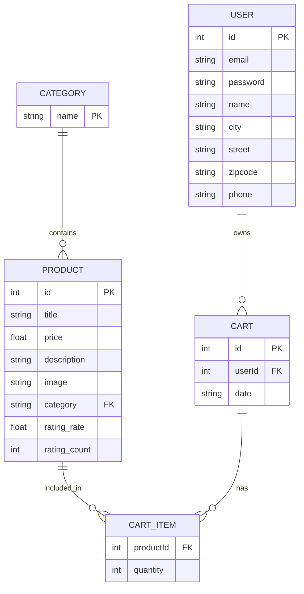
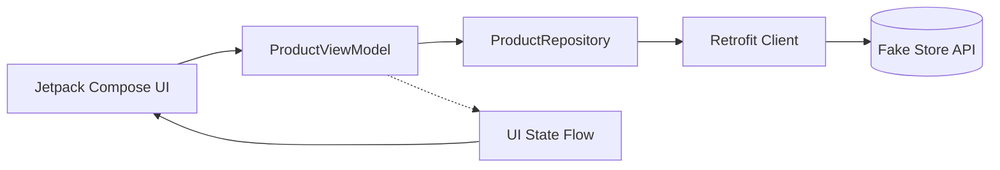

# StyleHub – Arquitectura y Modelado Móvil

## 🎯 Objetivo del Proyecto
Diseñar la arquitectura completa de StyleHub, una aplicación móvil Android nativa en Kotlin, actuando como arquitectos de software. El foco es la planificación y documentación mediante diagramas Mermaid, prototipado en Google Stitch, y la configuración del proyecto base en Android Studio bajo el patrón MVVM.

## 🚀 Fase 1: Selección de la API y Elevator Pitch
**API:** Fake Store API ([https://fakestoreapi.com](https://fakestoreapi.com))  

**Elevator Pitch:** "Nuestra app se llama StyleHub y consume la Fake Store API. El problema que resolvemos es que los usuarios no encuentran una forma rápida y organizada de visualizar un catálogo premium de productos de moda y accesorios. Usaremos cuatro recursos clave de la API: Product, Category, Cart y User."

## 📊 Fase 2: Modelado de Datos (Diagrama Entidad-Relación - Mermaid)

## 📱 Fase 3: Diseño UI/UX y Flujo de Navegación

*Enlace público a Google Stitch:* [Insertar enlace aquí]  

**Pantallas Planificadas:**
1. **Pantalla 1: Home (Catálogo)**  
   * Información: Muestra un LazyColumn o LazyVerticalGrid con los productos recuperados de `GET /products` (imagen, título, precio).  
   * Endpoint: `GET /products`  
   * Acciones: Navegación al detalle haciendo clic en un producto; filtrado por categorías.
2. **Pantalla 2: Detalle del Producto**  
   * Información: Imagen grande, descripción detallada, precio, categoría y rating.  
   * Endpoint: `GET /products/{id}`  
   * Acciones: Botón "Añadir al carrito" (simulado).
3. **Pantalla 3: Perfil de Usuario**  
   * Información: Datos personales del usuario.  
   * Endpoint: `GET /users/{id}`  

## 🏗️ Fase 4: Arquitectura y Consumo de la API

Diagrama de flujo MVVM en Mermaid:

**Tabla de Endpoints de la Fake Store API:**
| Endpoint | Método HTTP | Parámetros | Propósito en la App |
| :--- | :--- | :--- | :--- |
| `/products` | GET | Ninguno | Obtener lista de todos los productos del catálogo |
| `/products/{id}` | GET | `id` (int) | Obtener información detallada de un producto |
| `/products/categories` | GET | Ninguno | Obtener el listado de categorías para el filtrado |
| `/users` | GET | Ninguno | Obtener el perfil de los usuarios registrados |

## 🛠️ Fase 5: Proyecto Base en Android Studio
*   **Plantilla:** Empty Activity  
*   **Lenguaje:** Kotlin  
*   **Evidencia:** [Insertar Captura de pantalla del emulador mostrando "Hello Android!"]  

## 🎥 Fase 6: Video de Presentación
Enlace al video explicativo de máximo 5 minutos.  
[Insertar enlace a YouTube o Google Drive]  

## 📦 Fase 7: Gestión del Repositorio y GitHub Flow
Uso de ramas para hitos, Pull Requests, y Merging a la rama `main`.  

---